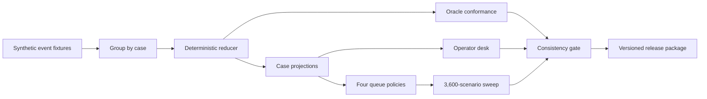

# x402 exception desk: a deterministic replay of synthetic payment incidents that compares four queue policies

[](https://github.com/RahilBhavan/x402-exception-desk/actions/workflows/verify.yml)
[](LICENSE)

**Live:** https://rahilbhavan.github.io/x402-exception-desk/

[](https://rahilbhavan.github.io/x402-exception-desk/)

**All data in this repository is synthetic.** The 65 events, the 16 incidents, every amount, identity, and handling time, and the 3,600-scenario sweep are generated fixtures. None of it is real Base payment traffic. The event shapes follow the public x402 v2 specification and the Base finality documentation.

This project is a settlement-to-delivery exception desk for x402 payments on Base. It asks two questions. When payment evidence and delivery evidence disagree, which case should an operator handle first? What evidence makes a retry, recovery, refund, or closure safe? The desk replays the events through one deterministic reducer, compares four queue policies on the 9 actionable cases, and produces an operator report, a decision memo, a reconciliation workbook, and a checksummed release package.

## Results

FIFO stays. The proposed replacement, deadline-first, had to cut overdue cases by at least 15% with zero control failures. That gate was set before the run. Deadline-first cut value-weighted overdue time by 64% but left the same 6 cases overdue, so it failed the gate.

| Policy | Overdue cases | Median delay (min) | p95 delay (min) | Value-weighted overdue (USDC-minutes) | Control failures |
|---|---|---|---|---|---|
| FIFO (baseline) | 6 | 66.1 | 107.1 | 4,428.9 | 0 |
| Deadline-first (proposed) | 6 | 55.1 | 107.1 | 1,582.2 | 0 |
| Value-first | 4 | 47.1 | 137.1 | 1,371.9 | 0 |
| Hybrid (SLA window, then value) | 4 | 77.1 | 127.1 | 982.1 | 0 |

Source: `artifacts/generated/policy-results.csv` (run `run-a6cf865a0efd58de`; value columns are atomic units divided by 10^6). Value-first and hybrid cut overdue cases to 4. They were added after the gate was set, they have not run on a held-out workload, and their p95 delay is worse than FIFO's.

A 3,600-scenario sweep shows that no policy wins every objective. The sweep crosses 100 seeds, 1 to 3 operators, 0.5x, 1x, or 2x handling time, 0 or 15 minutes of evidence delay, and 0 or 10 minutes of finality delay. The table gives the share of scenarios in which each policy had the best result:

| Objective | FIFO | Deadline-first | Value-first | Hybrid |
|---|---|---|---|---|
| Fewest overdue cases | 9.7% | 20.8% | **51.7%** | 17.8% |
| Least value-weighted overdue time | 7.4% | 22.0% | 30.1% | **40.5%** |
| Lowest p95 delay | **50.0%** | 11.1% | 17.6% | 21.3% |

Source: `artifacts/generated/scenario-sweep-summary.json`. Ties split the credit. Control failures tie at 25% each, because the seeded failures belong to the workload, not to the queue order. A team should pick its objective first and then the queue rule that serves it.

The state model keeps four facts apart:

- A timeout means the outcome is unknown, not failed, so it never triggers a new charge.
- Chain evidence shows payment, not delivery.
- A refund approval reserves balance but is not a settled refund.
- One piece of payment evidence cannot pay for two orders.

## How it works



The event log is the evidence boundary. An append-only SQLite store (`src/exception_desk/store.py`) holds the events. The reducer (`reducer.py`) folds them into case projections (`case_projection.py`), and every reconciliation row, operator view, and policy result derives from those projections. A separately written oracle (`data/incidents-v1.oracle.json`) states the expected outcome of all 16 incidents, and the reducer matches it on 16 of 16. The queue policies live in `policy.py` and the sweep in `experiments.py`. A 26-check consistency gate (`consistency.py`) ties every generated file to one run ID and to the fixture, oracle, and workload hashes. The code uses only the Python standard library.

## Run it

You need Python 3.9 or later. There are no third-party packages and no credentials.

```sh
git clone https://github.com/RahilBhavan/x402-exception-desk.git
cd x402-exception-desk
python3 scripts/release.py
```

`release.py` runs the tests, regenerates `artifacts/generated/`, and runs the consistency gate. It then checks the memo, workbook, and video against their recorded hashes and rebuilds the ZIP and its checksum. On success it prints `"status": "PASS"` and `"consistency_checks": 26`. CI runs the same command on Python 3.9 and 3.11.

To run the steps one at a time:

```sh
PYTHONPATH=src python3 -m unittest discover -s tests -v   # tests
PYTHONPATH=src python3 -m exception_desk.cli --root .     # regenerate outputs
```

Then open `artifacts/generated/operator-report.html` in a browser. On 2026-10-21 the suite ran 66 tests and passed (`Ran 66 tests`, `OK`).

The release checks the memo, workbook, and video, but it does not rebuild them. `work/build_memo.py` needs `reportlab`, and `work/build_demo.py` needs `Pillow` and `imageio-ffmpeg`. The workbook comes from a separate spreadsheet tool that is not part of this repository, so the committed workbook is the source of truth.

## Repository layout

- `01-brief/` to `06-execution/`: the decision brief, research, design, deliverable plan, validation, and build notes.
- `artifacts/`: the memo, workbook, video, runbook, state model, and reviewer documents.
- `artifacts/generated/`: outputs that `exception_desk.cli` regenerates, including the operator report.
- `data/`: the synthetic incident fixtures and the separate oracle.
- `docs/`: the README screenshot and the social card.
- `outputs/`: the release ZIP and checksum, copies of the rich artifacts, and the project guide.
- `scripts/`: `release.py` and the workbook metadata scrubber.
- `src/exception_desk/`: the store, reducer, projections, policies, sweep, export, and consistency gate.
- `tests/`: the `unittest` suite.
- `web/`: the operator report's CSS and JavaScript.
- `work/`: the scripts that build the memo and the demo video.

## Documentation

The `docs/` folder holds images only. The project documents are in the numbered folders and in `artifacts/`:

- [Decision brief](01-brief/decision.md): the business decision, the decision rule, and the claim boundary.
- [Source register](02-research/source-register.md) and [data feasibility](02-research/data-feasibility.md): the public sources, access limits, assumptions, and the chosen data candidate.
- [Design alternatives](03-design/alternatives.md) and [system design](03-design/system-design.md): the options considered and the chosen architecture.
- [Artifact plan](04-deliverables/artifact-plan.md) and [reviewer packet](artifacts/reviewer-packet.md): the deliverables, their acceptance criteria, and the review guide.
- [Release readiness](05-validation/release-readiness.md), [adversarial review](05-validation/adversarial-review.md), and [verification plan](05-validation/verification-plan.md): the checks run, the strongest weaknesses, and the scope cuts.
- [State model](artifacts/state-model.md), [operator runbook](artifacts/operator-runbook.md), and [validation report](artifacts/validation-report.md): the case states, the operator procedures, and the validated policy decision.
- [Complete project guide](outputs/complete-project-guide.md): the whole project in one long document.
- [Decision memo (PDF)](artifacts/operations-memo.pdf), [reconciliation workbook (XLSX)](artifacts/reconciliation.xlsx), [demo video](artifacts/demo.mp4), and [release package (ZIP)](outputs/x402-exception-desk-package.zip) with its [SHA-256 checksum](outputs/x402-exception-desk-package.zip.sha256).

## Scope and limits

- All data is synthetic: incidents, amounts, identities, handling times, arrival rates, and every result.
- No live payments. The desk uses no wallet, signs nothing, calls no facilitator, and sends no transactions.
- Handling times are model inputs, not measurements. The policy results show tradeoffs, not a production recommendation.
- No payments practitioner has reviewed the workflow yet. The [operator task protocol](artifacts/operator-task-protocol.md) describes that review.
- This is an independent project. It is not affiliated with or endorsed by Coinbase, and it does not describe any Coinbase system or process.

## License

[MIT](LICENSE). The license covers this project's code, not the x402 specification or the Base documentation it references.

Part of [Rahil Bhavan's projects](https://github.com/RahilBhavan).
